# ClinicalCare

[](https://github.com/lucasnoronhagois/clinicaldeploy/actions/workflows/ci.yml)


Read in: [Português](README.md) | **English**

Management system for multi-location clinics: appointment scheduling, patient records, rooms, staff with role based access, a dashboard with indicators and a productivity report.

The project is full stack (Node.js REST API in TypeScript and a React interface). It can also run **frontend only**, using an internal demo API that follows the same contract as the real API.

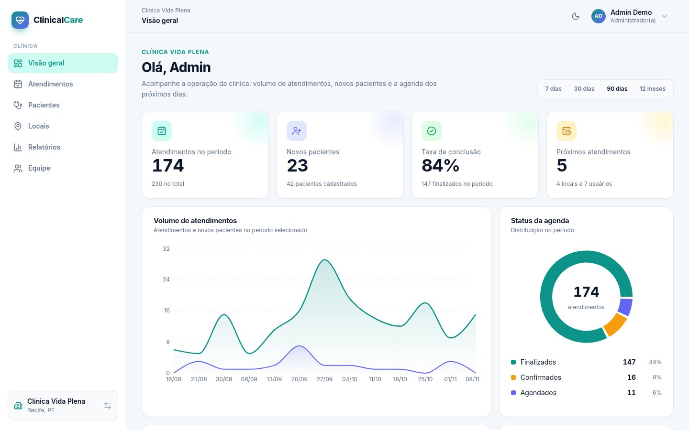

## Features

- JWT authentication with a persisted session and automatic sign out when the token expires
- Multi-clinic: data isolated per clinic; administrators and guests can switch between locations
- Appointments with a **scheduled, confirmed and finished** flow, filters by status, period and professional
- Patients with search by name or CPF (Brazilian tax id), CPF validation and appointment history
- Rooms and staff management (only administrators create users)
- Dashboard with appointment volume, schedule status, room usage and top professionals
- Productivity report per role, with an optional period and CSV export
- Light and dark themes, responsive layout, smooth transitions (respecting `prefers-reduced-motion`) and loading, empty and error states
- Accessibility: labelled fields, managed focus in dialogs, keyboard navigation and a skip to content link

The interface is in Brazilian Portuguese.

## Roles

| Role | Clinics | Can do |
| --- | --- | --- |
| Administrator (`root`) | All | Everything, including creating clinics and users |
| Doctor | Own clinic only | Appointments, patients, rooms and reports |
| Receptionist | Own clinic only | Appointments, patients, rooms and reports; bookings are recorded under their name |
| Guest | All | Read only; cannot see the staff list |

Rules are enforced by the API (and mirrored by the demo API): restricted roles always use the clinic from the token, and accessing a record from another clinic returns 404.

## Stack

| Layer | Technologies |
| --- | --- |
| Frontend | React 19, TypeScript, Vite 7, React Router 7, axios, Recharts, Motion, Lucide, CSS with design tokens |
| Internal demo API | Mock Service Worker (MSW 2) with deterministic fictitious data |
| API | Node.js, Express 4, TypeScript, Sequelize 6, MySQL 8 or MariaDB (optional SQLite), JWT, bcrypt, Yup, Helmet |
| Tests | Jest, Supertest (API); Vitest, Testing Library, MSW (frontend) |
| Quality and delivery | ESLint 9, GitHub Actions, Docker, Docker Compose, nginx |

## Architecture

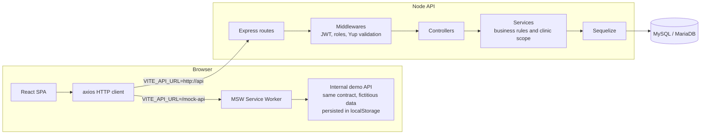

Main structure:

```
backend/
  src/
    app.ts              # createApp: helmet, cors, /api/health, routes, 404 and error handler
    config/             # env, Sequelize, sequelize-cli config
    controllers/ routes/ services/ middlewares/ schema/ models/
    migrations/         # sequelize-cli migrations
    seeders/            # demo seed (idempotent)
  tests/                # unit and integration (Supertest + in-memory SQLite)
frontend/
  src/
    components/         # UI (buttons, dialogs, fields, states) and layout
    features/           # forms
    pages/              # screens
    lib/                # HTTP client, formatting, validation, permissions
    mock/               # internal demo API (fixtures, rules, MSW handlers)
    test/               # unit, contract and page tests
```

## Internal demo API

The frontend always makes real HTTP calls through the same axios client. The base URL comes from `VITE_API_URL`:

| `VITE_API_URL` value | Who answers |
| --- | --- |
| `/mock-api` (default in `.env`) | Internal demo API, served by Mock Service Worker inside the app |
| `http://localhost:3000` (or the deployed URL) | The real Node API from this repository |

The internal API (`frontend/src/mock`) implements the same routes, JSON shapes, status codes (200, 201, 400, 401, 403, 404, 409) and error messages as the Node API, including role rules and clinic scoping. Data is generated by a seeded pseudo random generator relative to the current date (the schedule always has recent and upcoming appointments), and changes are kept in the browser `localStorage`. The user menu has a **Restaurar dados de demonstração** (restore demo data) option.

Simulated latency is configurable with `VITE_MOCK_LATENCY_MS` (default 350 ms). Switching to the real API only requires changing `VITE_API_URL` and rebuilding.

## Running locally

Requirements: Node.js 20 or newer (CI uses Node 22).

### Option 1: frontend only, with the internal API (fastest)

```bash
cd frontend
cp .env.example .env     # VITE_API_URL=/mock-api
npm install
npm run dev              # http://localhost:5173
```

### Option 2: Docker Compose (MySQL + API + frontend)

```bash
docker compose up --build
```

- Frontend: http://localhost:8080 (built with `VITE_API_URL=http://localhost:3000`)
- API: http://localhost:3000/api/health
- The API container runs migrations and loads the demo data (`SEED_DEMO_DATA=true`).

### Option 3: API and frontend locally, without Docker

With MySQL 8 or MariaDB running:

```sql
CREATE DATABASE clinicalcare;
CREATE USER 'clinicalcare'@'localhost' IDENTIFIED BY 'clinicalcare';
GRANT ALL ON clinicalcare.* TO 'clinicalcare'@'localhost';
```

```bash
# API
cd backend
cp .env.example .env     # adjust DB_* and JWT_SECRET if needed
npm install
npm run db:setup         # migrations + demo data
npm run dev              # http://localhost:3000

# Frontend (another terminal)
cd frontend
cp .env.example .env
# in .env: VITE_API_URL=http://localhost:3000
npm install
npm run dev
```

Without a database server, the API also runs on SQLite: in `backend/.env` set `DB_DIALECT=sqlite` and `DB_STORAGE=./clinicalcare.sqlite` (tables are created automatically) and run `npm run seed`.

### Useful scripts

| Folder | Command | What it does |
| --- | --- | --- |
| backend | `npm run dev` | API with hot reload (tsx) |
| backend | `npm run seed:reset` | Recreates the demo data |
| backend | `npm run build` and `npm start` | TypeScript build, migrations and server |
| both | `npm run lint`, `npm run typecheck` | ESLint and type checking |
| both | `npm test`, `npm run test:coverage` | Tests and coverage |
| frontend | `npm run build`, `npm run preview` | Production build and preview |

## Demo credentials

Every account uses the password `demo123`. The login screen has quick access buttons.

| Login | Role | Clinic |
| --- | --- | --- |
| `admin` | Administrator | All |
| `medico` | Doctor (Dra. Marina Albuquerque) | Clínica Vida Plena |
| `recepcao` | Receptionist (Carla Nogueira) | Clínica Vida Plena |
| `visitante` | Guest (read only) | All |

Other users: `rafael.teixeira`, `beatriz.monteiro`, `diego.farias` (Clínica Vida Plena) and `tiago.moreira`, `larissa.pacheco`, `paula.mendes` (Centro Médico Bem Viver).

All data is fictitious: randomly combined names, CPFs generated only with valid check digits, phone numbers with the `90000` prefix and emails on the reserved `.example` domain.

## Tests and coverage

Numbers from the latest local run (`npm run test:coverage`):

| Project | Tests | Statements | Branches | Functions | Lines |
| --- | --- | --- | --- | --- | --- |
| API (Jest + Supertest) | 119 tests in 13 suites | 97.53% | 86.74% | 98.00% | 98.20% |
| Frontend (Vitest + Testing Library) | 85 tests in 12 files | 76.71% | 74.06% | 71.92% | 78.47% |

- **API:** route integration tests on in-memory SQLite (authentication, roles, clinic scoping, validation, conflicts, dashboard, reports and seed) plus unit tests for configuration, validation and data generation. `server.ts`, the seed script and migrations are excluded from coverage.
- **Frontend:** contract tests for the internal API through the real axios client over MSW (routes, status codes, errors, latency, switching `VITE_API_URL`), page tests (login, protected routes, patients, appointments, dashboard, reports and staff) and unit tests for formatting, validation, session and permissions. `main.tsx` and the file that starts the browser Service Worker are excluded from coverage.

CI (GitHub Actions) runs lint, typecheck, tests with coverage and build for both API and frontend on every push and pull request.

## Screenshots

| | |
| --- | --- |
| 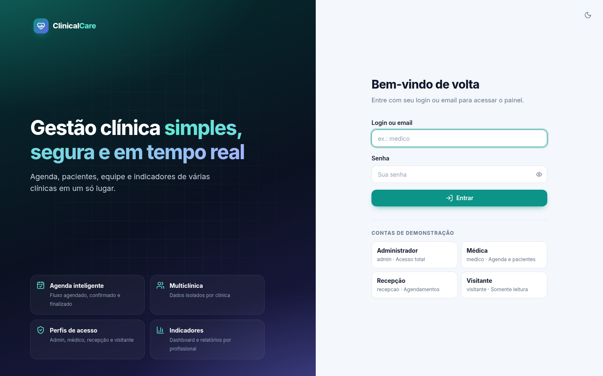 | 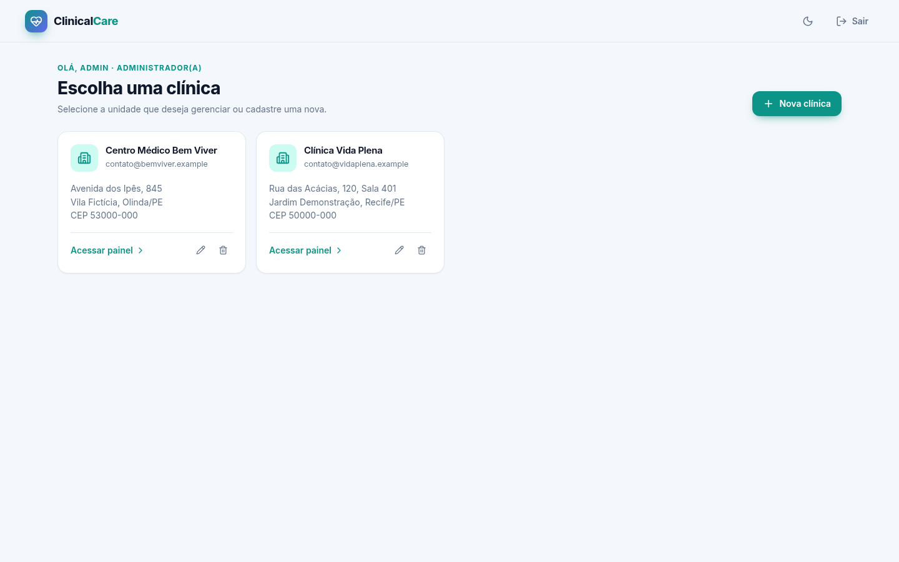 |
| 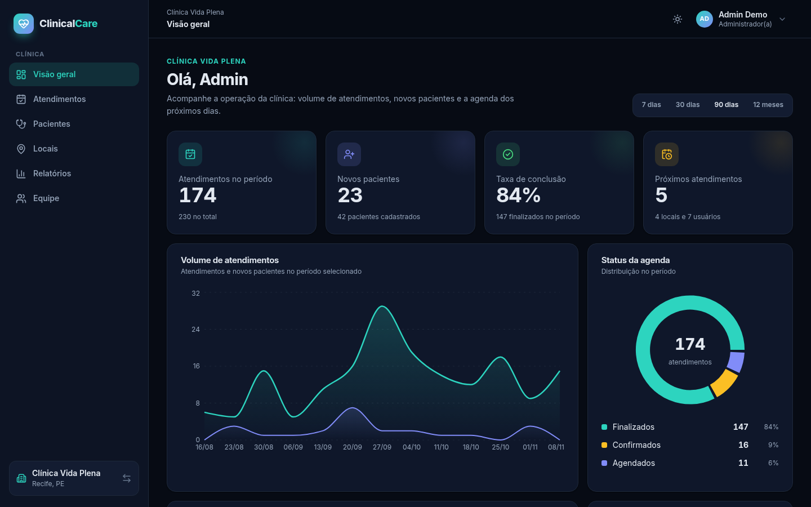 | 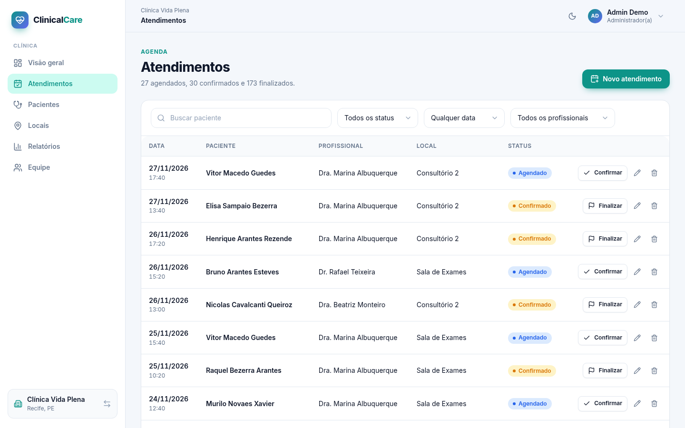 |
| 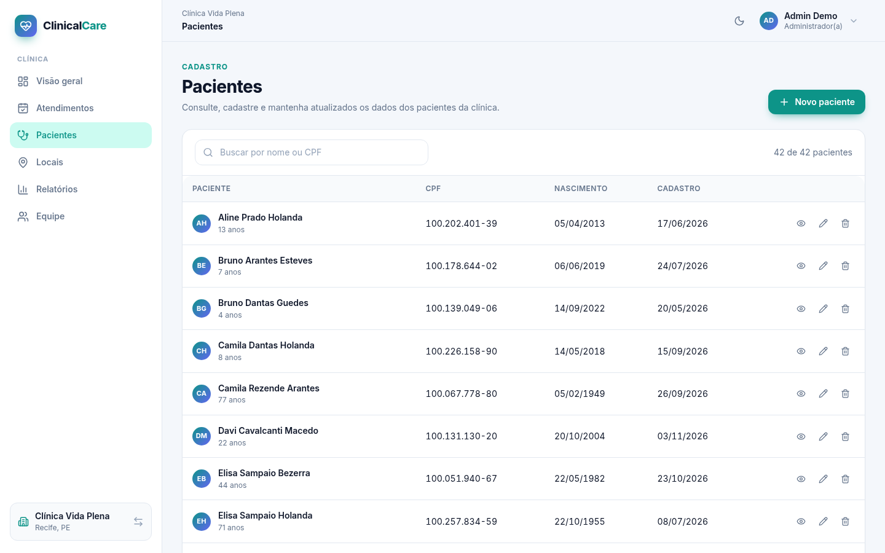 | 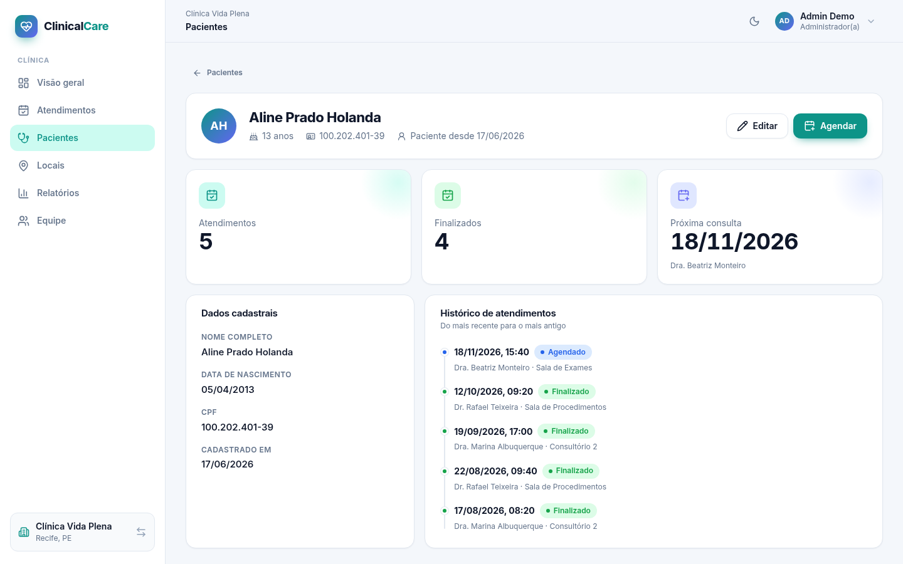 |
| 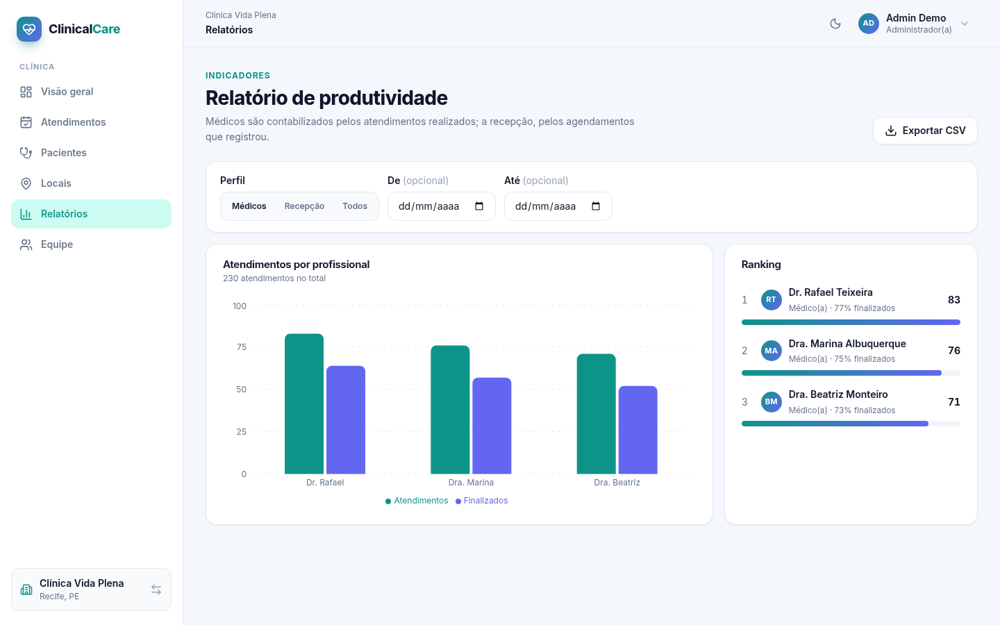 | 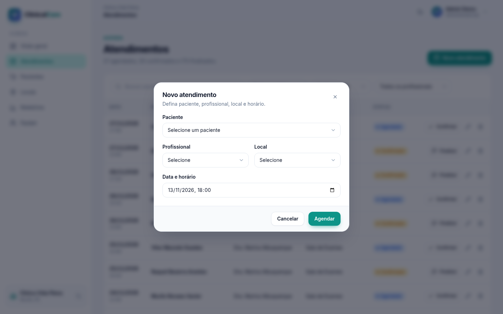 |

<p align="center">
  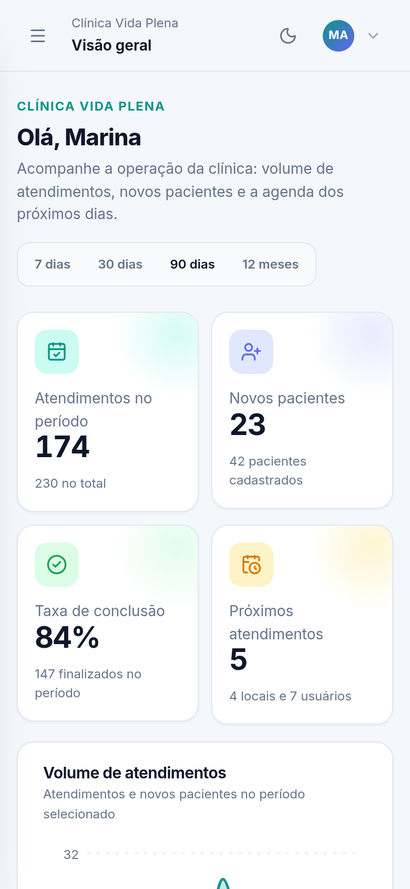
  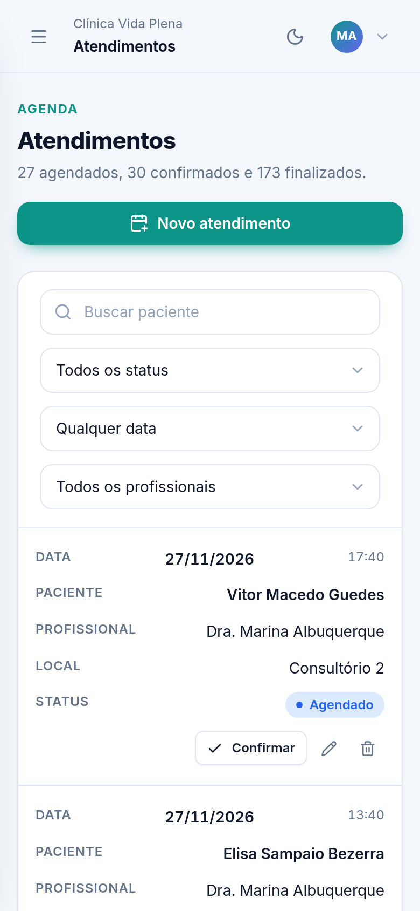
</p>

## Deployment

**Frontend on Vercel** (`frontend` folder; `vercel.json` already sets the SPA fallback):

- To publish the frontend alone with the internal API, set `VITE_API_URL=/mock-api` (or leave it unset; that is the default).
- To use the real API, set `VITE_API_URL` to the public API URL.

**API on a Node host** (Render, Railway, Runway, Fly.io or similar, `backend` folder):

- Build: `npm ci && npm run build`. Start: `npm start` (runs migrations and starts the server). Health check: `GET /api/health`.
- Variables: `NODE_ENV=production`, `JWT_SECRET` (long random value), `JWT_EXPIRES_IN`, `CORS_ORIGIN` (frontend URL), `DB_DIALECT`, `DB_HOST`, `DB_PORT`, `DB_NAME`, `DB_USER`, `DB_PASS`.
- To load the demo data once: `npm run seed:prod`.
- `backend/Dockerfile` can also be used directly on hosts that accept containers.

## License

[MIT](LICENSE) © 2025-2026 Lucas Noronha Gois
