# ClinicalCare

[](https://github.com/lucasnoronhagois/clinicaldeploy/actions/workflows/ci.yml)


Leia em: **Português** | [English](README.en.md)

Sistema de gestão para clínicas com várias unidades: agenda de atendimentos, cadastro de pacientes, locais de atendimento, equipe com perfis de acesso, dashboard com indicadores e relatório de produtividade.

O projeto é full stack (API REST em Node.js com TypeScript e interface em React) e também pode rodar **só com o front**, usando uma API interna de demonstração que segue o mesmo contrato da API real.

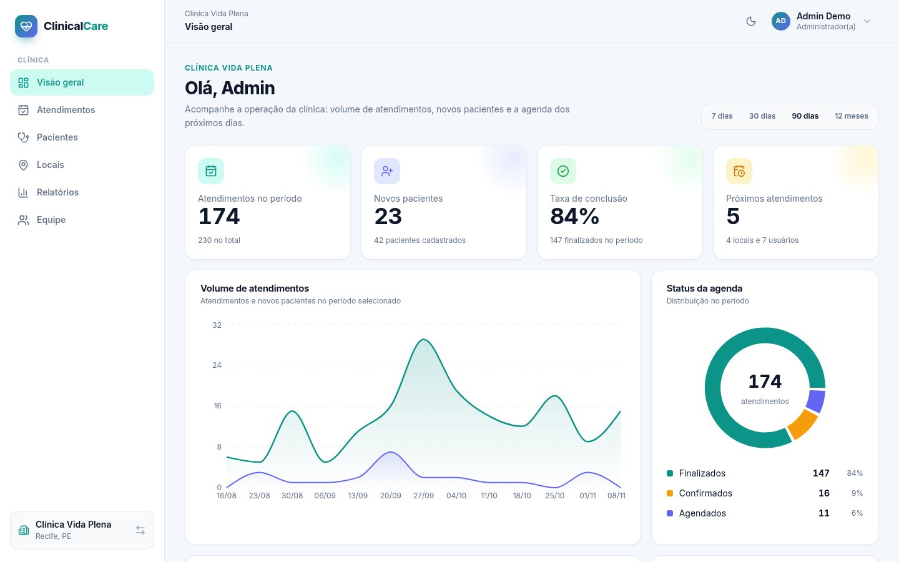

## Funcionalidades

- Autenticação com JWT, sessão persistida e encerramento automático quando o token expira
- Multiclínica: dados isolados por clínica; administradores e visitantes alternam entre unidades
- Agenda com fluxo **agendado, confirmado e finalizado**, filtros por status, período e profissional
- Pacientes com busca por nome ou CPF, validação de CPF e histórico de atendimentos
- Locais de atendimento e gestão de equipe (somente administradores criam usuários)
- Dashboard com volume de atendimentos, status da agenda, uso dos locais e profissionais em destaque
- Relatório de produtividade por perfil, com período opcional e exportação em CSV
- Tema claro e escuro, layout responsivo, transições suaves (respeitando `prefers-reduced-motion`) e estados de carregamento, vazio e erro
- Acessibilidade: rótulos associados aos campos, foco gerenciado em modais, navegação por teclado e link para pular ao conteúdo

## Perfis de acesso

| Perfil | Clínicas | Pode fazer |
| --- | --- | --- |
| Administrador (`root`) | Todas | Tudo, incluindo cadastrar clínicas e usuários |
| Médico(a) | Somente a própria | Agenda, pacientes, locais e relatórios |
| Recepção | Somente a própria | Agenda, pacientes, locais e relatórios; agendamentos ficam registrados no seu nome |
| Visitante | Todas | Somente leitura; não vê a lista da equipe |

As regras são aplicadas na API (e replicadas na API de demonstração): perfis restritos sempre usam a clínica do token, e o acesso a registros de outra clínica responde 404.

## Stack

| Camada | Tecnologias |
| --- | --- |
| Front | React 19, TypeScript, Vite 7, React Router 7, axios, Recharts, Motion, Lucide, CSS com design tokens |
| API interna de demonstração | Mock Service Worker (MSW 2) com dados fictícios gerados de forma determinística |
| API | Node.js, Express 4, TypeScript, Sequelize 6, MySQL 8 ou MariaDB (SQLite opcional), JWT, bcrypt, Yup, Helmet |
| Testes | Jest, Supertest (API); Vitest, Testing Library, MSW (front) |
| Qualidade e entrega | ESLint 9, GitHub Actions, Docker, Docker Compose, nginx |

## Arquitetura

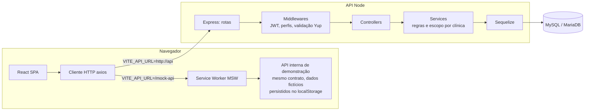

Estrutura principal:

```
backend/
  src/
    app.ts              # createApp: helmet, cors, /api/health, rotas, 404 e tratador de erros
    config/             # env, Sequelize, configuração do sequelize-cli
    controllers/ routes/ services/ middlewares/ schema/ models/
    migrations/         # migrações do sequelize-cli
    seeders/            # seed de demonstração (idempotente)
  tests/                # unitários e integração (Supertest + SQLite em memória)
frontend/
  src/
    components/         # UI (botões, modais, campos, estados) e layout
    features/           # formulários de cadastro
    pages/              # telas
    lib/                # cliente HTTP, formatação, validação, permissões
    mock/               # API interna de demonstração (fixtures, regras, handlers MSW)
    test/               # testes de unidade, contrato e páginas
```

## API interna de demonstração

O front sempre faz chamadas HTTP reais com o mesmo cliente axios. A URL base vem de `VITE_API_URL`:

| Valor de `VITE_API_URL` | Quem responde |
| --- | --- |
| `/mock-api` (padrão no `.env`) | API interna de demonstração, servida pelo Mock Service Worker dentro do próprio app |
| `http://localhost:3000` (ou a URL publicada) | API Node real deste repositório |

A API interna (`frontend/src/mock`) implementa as mesmas rotas, formatos JSON, códigos de status (200, 201, 400, 401, 403, 404, 409) e mensagens de erro da API Node, incluindo as regras de perfil e o escopo por clínica. Os dados são gerados com um gerador pseudoaleatório com semente fixa, relativos à data atual (a agenda sempre tem atendimentos recentes e futuros), e as alterações ficam no `localStorage` do navegador. O menu do usuário tem a opção **Restaurar dados de demonstração**.

A latência simulada é configurável por `VITE_MOCK_LATENCY_MS` (padrão 350 ms). Trocar para a API real é só mudar `VITE_API_URL` e gerar o build de novo.

## Como rodar

Requisitos: Node.js 20 ou superior (CI usa Node 22).

### Opção 1: só o front, com a API interna (mais rápido)

```bash
cd frontend
cp .env.example .env     # VITE_API_URL=/mock-api
npm install
npm run dev              # http://localhost:5173
```

### Opção 2: Docker Compose (MySQL + API + front)

```bash
docker compose up --build
```

- Front: http://localhost:8080 (build com `VITE_API_URL=http://localhost:3000`)
- API: http://localhost:3000/api/health
- O container da API aplica as migrações e carrega os dados de demonstração (`SEED_DEMO_DATA=true`).

### Opção 3: API e front locais, sem Docker

Com um MySQL 8 ou MariaDB rodando:

```sql
CREATE DATABASE clinicalcare;
CREATE USER 'clinicalcare'@'localhost' IDENTIFIED BY 'clinicalcare';
GRANT ALL ON clinicalcare.* TO 'clinicalcare'@'localhost';
```

```bash
# API
cd backend
cp .env.example .env     # ajuste DB_* e JWT_SECRET se necessário
npm install
npm run db:setup         # migrações + dados de demonstração
npm run dev              # http://localhost:3000

# Front (outro terminal)
cd frontend
cp .env.example .env
# no .env: VITE_API_URL=http://localhost:3000
npm install
npm run dev
```

Sem servidor de banco, a API também roda com SQLite: no `backend/.env`, use `DB_DIALECT=sqlite` e `DB_STORAGE=./clinicalcare.sqlite` (as tabelas são criadas automaticamente) e rode `npm run seed`.

### Scripts úteis

| Pasta | Comando | O que faz |
| --- | --- | --- |
| backend | `npm run dev` | API com recarga automática (tsx) |
| backend | `npm run seed:reset` | Recria os dados de demonstração |
| backend | `npm run build` e `npm start` | Build TypeScript, migrações e servidor |
| ambos | `npm run lint`, `npm run typecheck` | ESLint e checagem de tipos |
| ambos | `npm test`, `npm run test:coverage` | Testes e cobertura |
| frontend | `npm run build`, `npm run preview` | Build de produção e pré-visualização |

## Credenciais de demonstração

Todas as contas usam a senha `demo123`. A tela de login tem botões de acesso rápido.

| Login | Perfil | Clínica |
| --- | --- | --- |
| `admin` | Administrador | Todas |
| `medico` | Médica (Dra. Marina Albuquerque) | Clínica Vida Plena |
| `recepcao` | Recepção (Carla Nogueira) | Clínica Vida Plena |
| `visitante` | Visitante (somente leitura) | Todas |

Outros usuários: `rafael.teixeira`, `beatriz.monteiro`, `diego.farias` (Clínica Vida Plena) e `tiago.moreira`, `larissa.pacheco`, `paula.mendes` (Centro Médico Bem Viver).

Todos os dados são fictícios: nomes combinados aleatoriamente, CPFs gerados apenas com dígitos verificadores válidos, telefones com prefixo `90000` e emails no domínio reservado `.example`.

## Testes e cobertura

Números da última execução local (`npm run test:coverage`):

| Projeto | Testes | Statements | Branches | Functions | Lines |
| --- | --- | --- | --- | --- | --- |
| API (Jest + Supertest) | 119 testes em 13 suítes | 97,53% | 86,74% | 98,00% | 98,20% |
| Front (Vitest + Testing Library) | 85 testes em 12 arquivos | 76,71% | 74,06% | 71,92% | 78,47% |

- **API:** testes de integração das rotas sobre SQLite em memória (autenticação, perfis, escopo por clínica, validação, conflitos, dashboard, relatórios e seed) e testes unitários de configuração, validação e geração de dados. `server.ts`, o script de seed e as migrações ficam fora da cobertura.
- **Front:** testes de contrato da API interna feitos pelo cliente axios real via MSW (rotas, status, erros, latência, troca de `VITE_API_URL`), testes de páginas (login, rotas protegidas, pacientes, atendimentos, dashboard, relatórios e equipe) e testes unitários de formatação, validação, sessão e permissões. `main.tsx` e o arquivo que inicia o Service Worker no navegador ficam fora da cobertura.

O CI (GitHub Actions) roda lint, typecheck, testes com cobertura e build para API e front a cada push e pull request.

## Telas

| | |
| --- | --- |
|  | 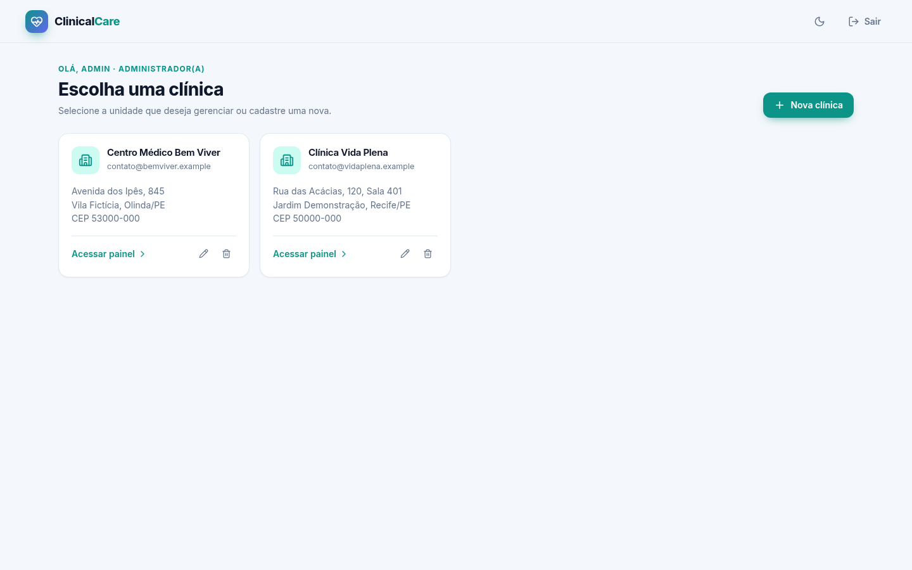 |
| 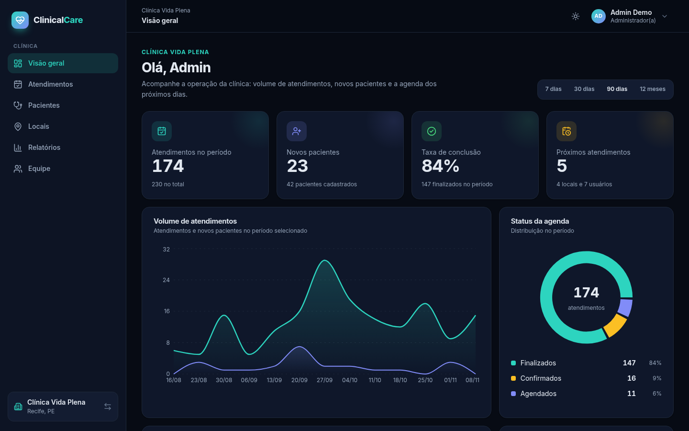 | 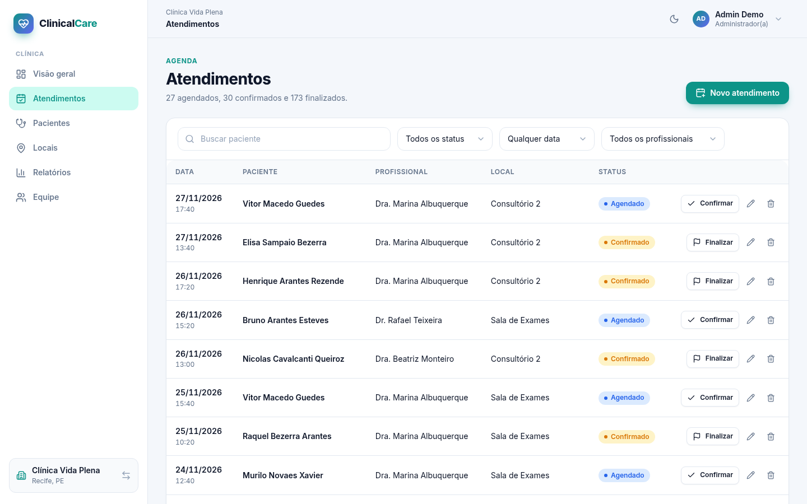 |
| 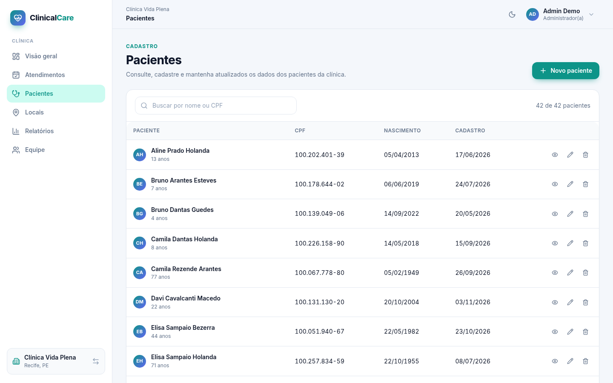 | 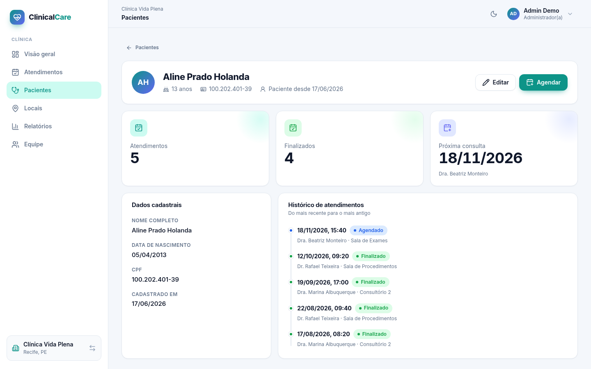 |
| 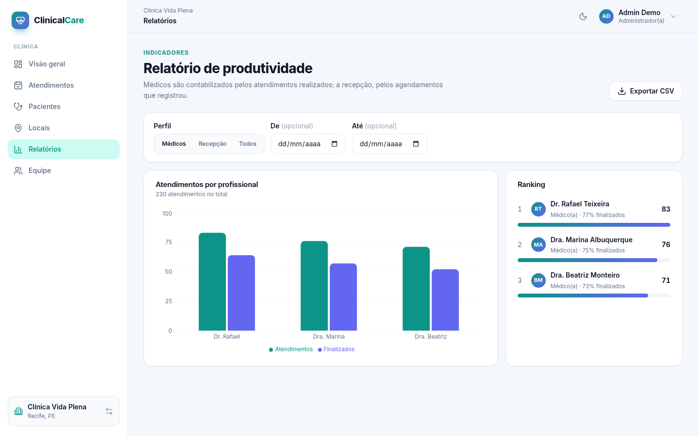 | 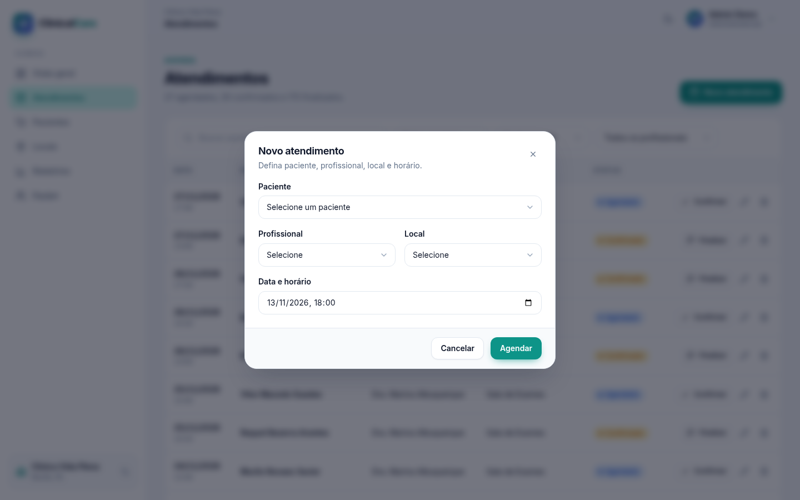 |

<p align="center">
  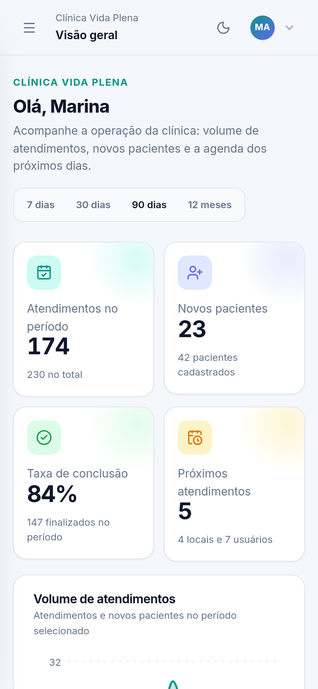
  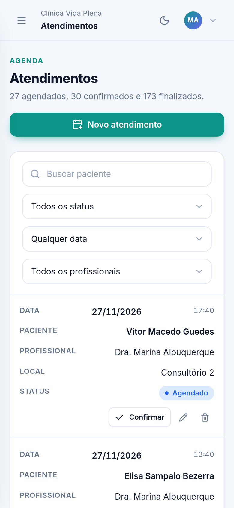
</p>

## Deploy

**Front na Vercel** (pasta `frontend`, `vercel.json` já configura o fallback da SPA):

- Para publicar só o front com a API interna, defina `VITE_API_URL=/mock-api` (ou deixe sem definir; esse é o padrão).
- Para usar a API real, defina `VITE_API_URL` com a URL pública da API.

**API em um host Node** (Render, Railway, Runway, Fly.io ou similar, pasta `backend`):

- Build: `npm ci && npm run build`. Start: `npm start` (aplica as migrações e sobe o servidor). Health check: `GET /api/health`.
- Variáveis: `NODE_ENV=production`, `JWT_SECRET` (valor longo e aleatório), `JWT_EXPIRES_IN`, `CORS_ORIGIN` (URL do front), `DB_DIALECT`, `DB_HOST`, `DB_PORT`, `DB_NAME`, `DB_USER`, `DB_PASS`.
- Para carregar os dados de demonstração uma vez: `npm run seed:prod`.
- O `backend/Dockerfile` também pode ser usado diretamente em hosts que aceitam containers.

## Licença

[MIT](LICENSE) © 2025-2026 Lucas Noronha Gois
